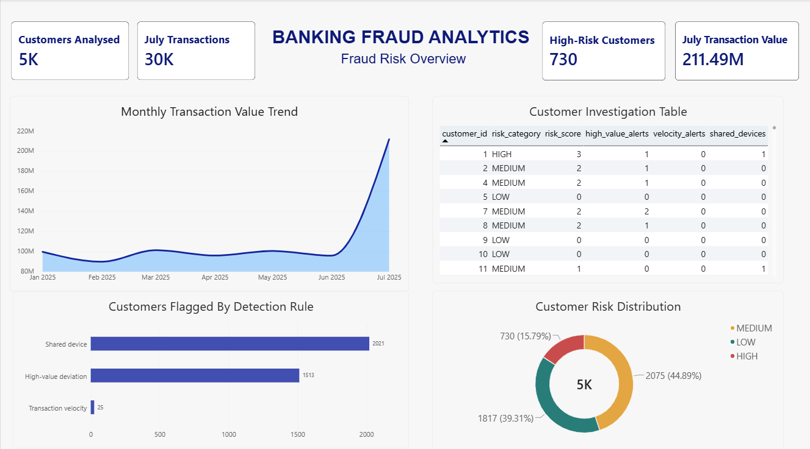

# Banking Fraud Intelligence & Investigation Analytics Platform

## Overview

The Banking Fraud Intelligence & Investigation Analytics Platform is a SQL- and Power BI-based analytical project designed to identify unusual banking transaction patterns, prioritise customers for further investigation, and communicate potential fraud risks through an interactive dashboard.

The platform uses historical customer transaction behaviour to establish baselines, applies explainable rule-based detection techniques, and consolidates the results into customer-level risk summaries.

**Important:** Detection flags represent suspicious activity candidates for investigation. They do not establish confirmed fraud.

## Objectives

- Analyse banking transaction patterns and customer behaviour.
- Establish historical transaction baselines.
- Identify unusual transaction activity using rule-based detection.
- Prioritise customers based on multiple risk indicators.
- Present investigation insights through an interactive Power BI dashboard.

## Technology Stack

| Technology | Purpose |
|---|---|
| PostgreSQL | Database management and SQL analysis |
| SQL | Data validation, exploration and fraud detection |
| Power BI | Dashboard development and visualisation |
| DAX | Dashboard measures and calculations |
| Git & GitHub | Version control and project documentation |

## Dataset Overview

The project uses a synthetic banking dataset containing:

| Dataset | Records |
|---|---:|
| Customers | 5,000 |
| Accounts | 7,500 |
| Transactions | 200,000 |
| Merchants | 300 |
| Devices | 5,000 |
| Locations | 15 |
| Beneficiaries | 2,000 |
| Ground-truth records | 2,000 |

The transaction period covers January–July 2025.

- **January–June 2025:** Historical period used to establish customer behaviour baselines.
- **July 2025:** Investigation period used to identify unusual activity.

Eight types of suspicious scenarios were synthetically injected into the dataset for evaluation.

## Detection Methodology

The platform implements three rule-based detection techniques:

### 1. High-Value Behavioural Deviation
Identifies successful transactions that significantly exceed a customer's historical transaction amount patterns, using the historical average and 95th percentile as reference points.

### 2. Transaction Velocity
Identifies customers with at least five successful transactions within a rolling 10-minute window.

### 3. Shared Device Detection
Identifies devices associated with three or more distinct customers during the investigation period.

## Customer Risk Prioritisation

The three detection rules contribute to a consolidated customer risk score:

| Detection Indicator | Risk Points |
|---|---:|
| High-value deviation | 2 |
| Transaction velocity | 2 |
| Shared device | 1 |

Risk categories are assigned as follows:

- **HIGH:** Risk score of 3 or above
- **MEDIUM:** Risk score of 1–2
- **LOW:** Risk score of 0

The scoring system is rule-based and intended to support investigation prioritisation, not to determine whether fraud has occurred.

## Power BI Dashboard

The Power BI dashboard provides an overview of customer risk, transaction trends, and detection-rule results.

### Dashboard Preview



The dashboard includes:

- Key performance indicators for customers and transaction activity.
- Customer risk category distribution.
- Monthly transaction value trends.
- Customers flagged by detection rule.
- Customer-level investigation details.

## Project Structure

```text
banking-fraud-intelligence/
│
├── database/
│   ├── banking_fraud_schema.sql
│   ├── data_validation.sql
│   ├── exploratory_analysis.sql
│   ├── customer_behavior_analysis.sql
│   ├── velocity_analysis.sql
│   ├── shared_device_analysis.sql
│   └── customer_risk_prioritisation.sql
│
├── docs/
│   ├── data_dictionary.md
│   └── data_generation_plan.md
│
├── powerbi/
│   ├── banking_analytics.pbix
│   └── dashboard_screenshot.png
│
├── .gitignore
├── LICENSE
└── README.md
```

## Limitations and Assumptions

- The dataset is synthetic and does not represent actual bank customers or transactions.
- Ground-truth records are synthetic evaluation labels, not verified real-world fraud outcomes.
- The implemented detection rules identify potential anomalies, not confirmed fraudulent transactions.
- A customer with no alerts is not necessarily free from suspicious activity.
- The risk score uses a simple rule-based weighting approach and is not a calibrated fraud probability.
- Geographic and other simulated attributes should be interpreted within the assumptions of the synthetic dataset.

## Future Scope

- Introduce additional behavioural and network-based detection rules.
- Evaluate detection performance against synthetic ground-truth labels.
- Incorporate investigation outcomes and feedback into prioritisation.
- Explore more advanced risk scoring and anomaly detection techniques.

## Disclaimer

This project is developed for educational and portfolio purposes using synthetic data. It is not intended for deployment in a production banking or fraud prevention environment.